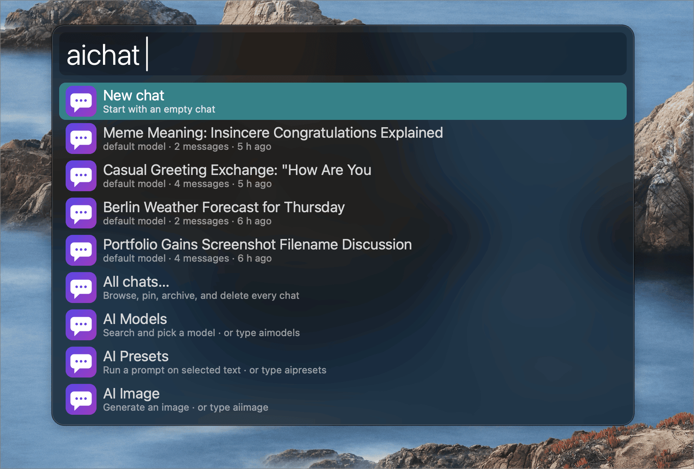
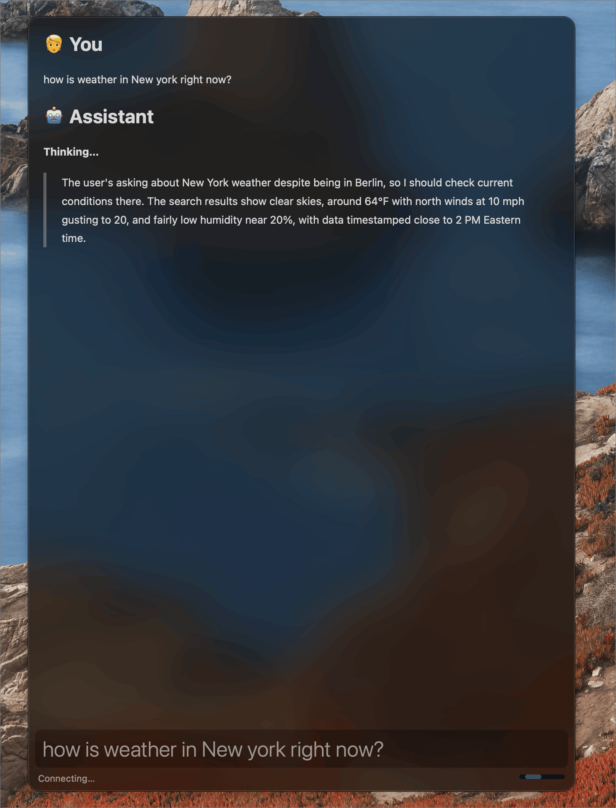
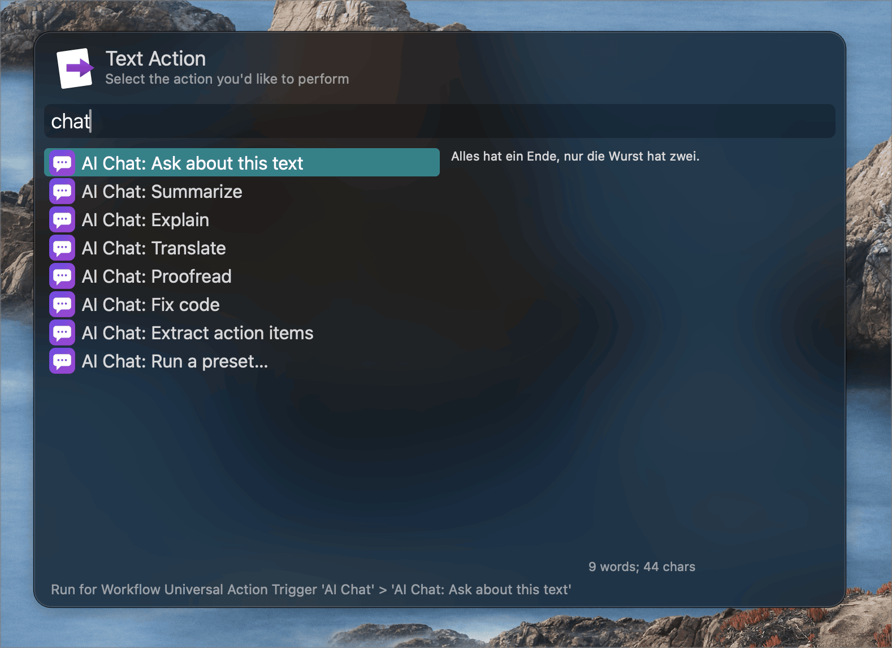
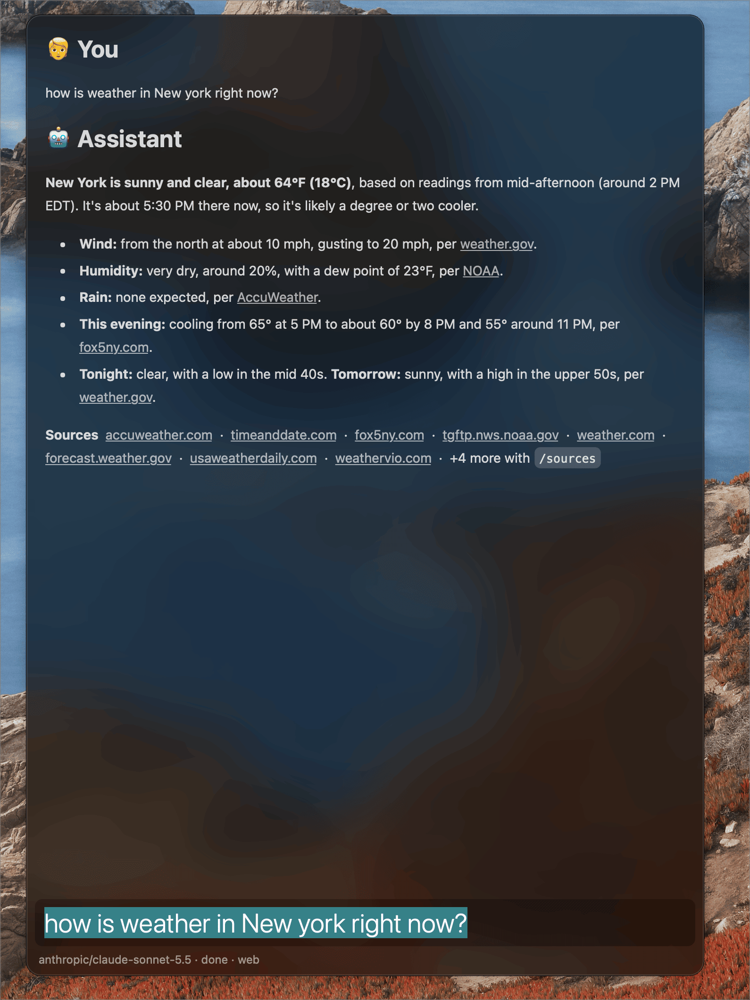
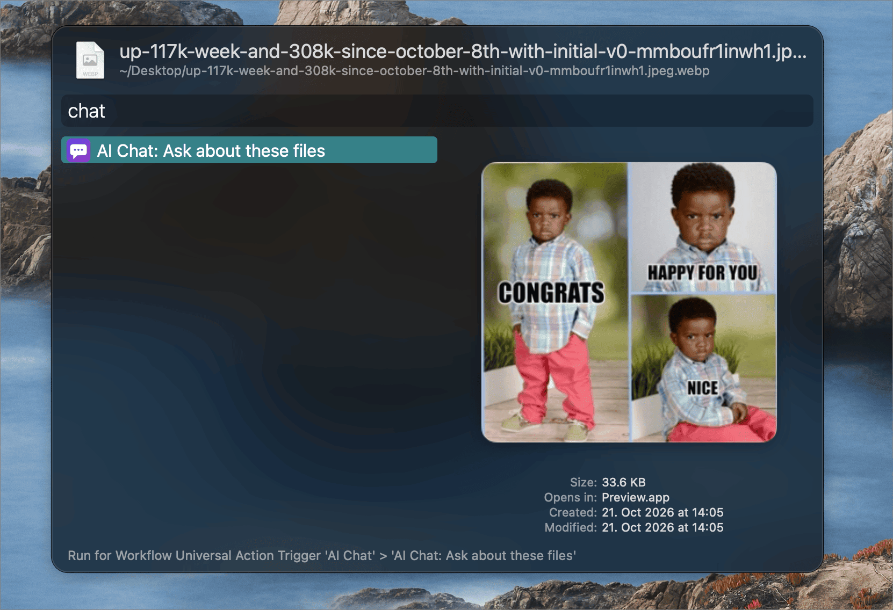
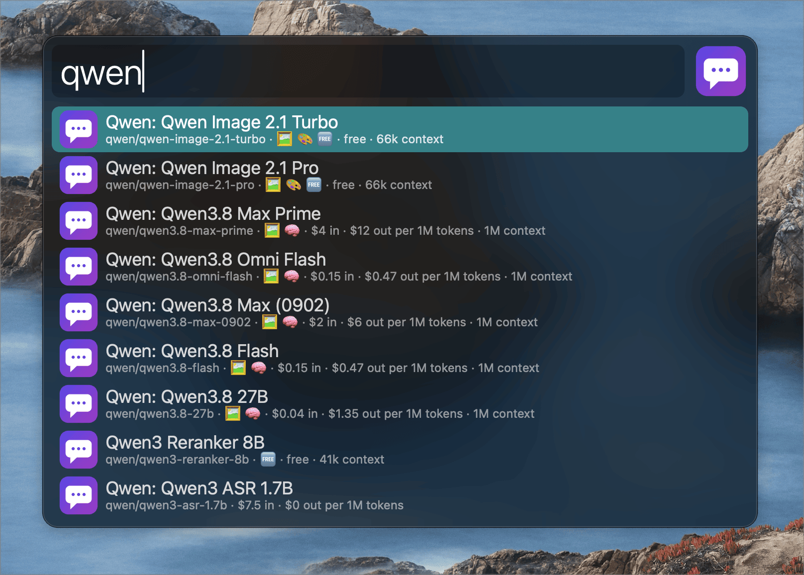
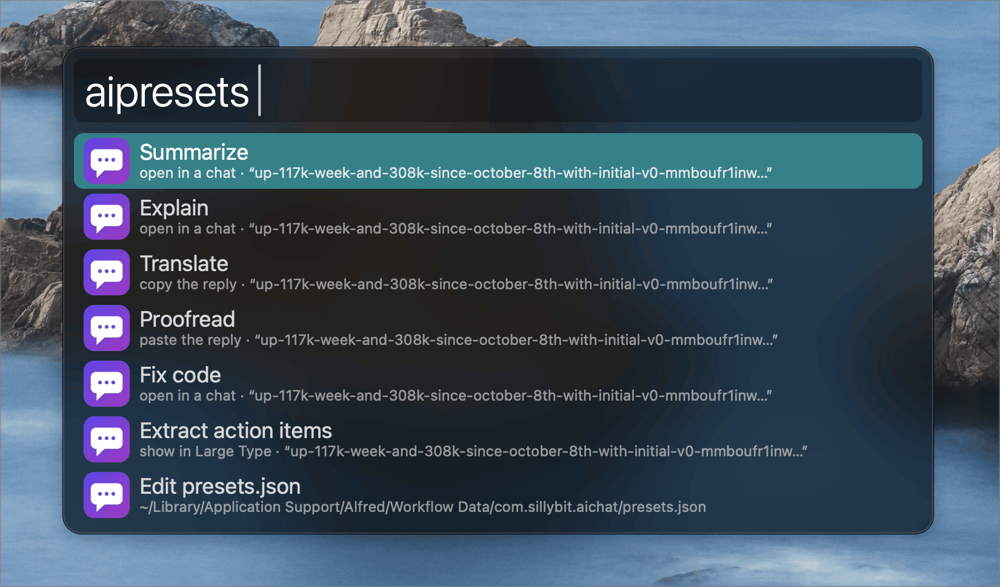
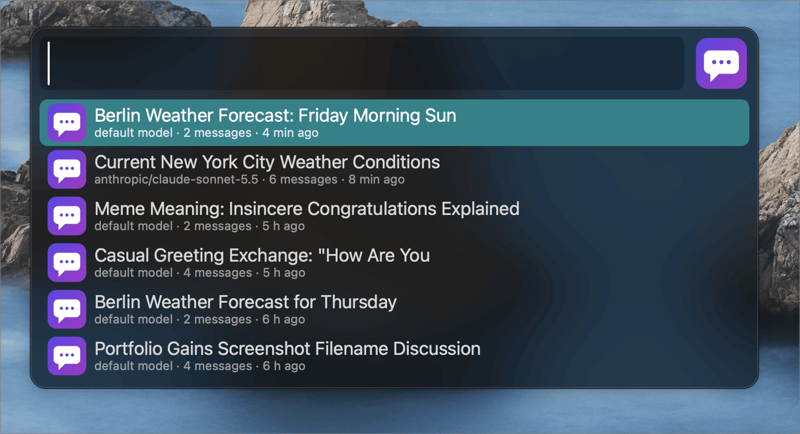

# AI Chat

An [Alfred](https://www.alfredapp.com) workflow for chatting with any [OpenRouter](https://openrouter.ai) model. It streams replies, takes images, PDFs, and text files, runs prompt presets on selected text, and generates images. It runs on the scripts macOS already has, so there is nothing else to install.

Needs macOS 14 or later and Alfred 5.5 or later with the Powerpack.

## Usage

### Chat

Chat with a model, with the reply streaming into a Text View, via the `aichat` keyword.

Typing `aichat` shows a list: **Continue** your current chat, start a **New chat**, open one of your recent chats, or jump to the models, presets, and image lists. Text you type after the keyword is what Continue and New chat send, and it filters the chats below them.

* <kbd>↩︎</kbd> Continue the chat (sending the text you typed) or open the chat you picked.
* <kbd>⌘</kbd><kbd>↩︎</kbd> On Continue, start a new chat instead. On a chat, archive or restore it.
* <kbd>⌥</kbd><kbd>↩︎</kbd> On a chat, pin or unpin it.
* <kbd>⌃</kbd><kbd>↩︎</kbd> On a chat, move it to the Trash.

* <kbd>↩︎</kbd> Send the message.
* <kbd>⌘</kbd><kbd>↩︎</kbd> Start a new chat.
* <kbd>⌥</kbd><kbd>↩︎</kbd> Copy the last reply.
* <kbd>⌃</kbd><kbd>↩︎</kbd> Copy the whole chat.
* <kbd>⇧</kbd><kbd>↩︎</kbd> Stop the reply and keep what has arrived.
* <kbd>⌘</kbd><kbd>⌥</kbd><kbd>↩︎</kbd> Go back to the chat list. <kbd>esc</kbd> closes Alfred, as everywhere else; use this to go back instead. Text you typed carries over to the list.

Alternatively, select text anywhere and use the **AI Chat: Ask about this text** Universal Action. Press <kbd>⌘</kbd><kbd>↩︎</kbd> to ask in a new chat.

A reply that stalls, fails, or is cut off keeps its text, and a message that could not be sent stays in the input. Type `/retry` to send it again.

Replies that used web search end with one line of short links, one per site. Type `/sources` to list every source in full. The Sources setting can add each site's icon before its link; that is experimental, because Alfred cannot make an icon itself a link.

The system prompt is set in the configuration. It starts from a prompt for short, direct, Markdown answers, and the workflow adds the current date, time, timezone, and macOS version to it, so the model knows what day it is.

### Send files

Send images, PDFs, and text files with your next message by selecting them in Alfred, opening the Universal Actions, and typing `chat` to find **AI Chat: Ask about these files**. Press <kbd>⌘</kbd><kbd>↩︎</kbd> to attach them to a new chat.

Alternatively, type `/attach` in a chat to pick files, or `/paste` to attach the image on your clipboard. Files are copied into the chat when you attach them, so moving the original does no harm. A message carries up to 8 files of up to 20 MB each. PDFs go to models that read them directly and to a free parser for the rest; `/pdf` changes that.

### Pick a model

Search models by name, price, and what they accept, and pick one for this chat, via the `aimodels` keyword.

* <kbd>↩︎</kbd> Use the model in the current chat.
* <kbd>⌘</kbd><kbd>↩︎</kbd> Make it the default model.
* <kbd>⌥</kbd><kbd>↩︎</kbd> Add or remove a favorite. Favorites are listed first.
* <kbd>⌃</kbd><kbd>↩︎</kbd> Copy the model id.

Add `#image` (reads images), `#imagegen` (makes images), `#file`, `#free`, or `#reasoning` to the search to filter. Alternatively, type `/model` in a chat.

### Run a preset

Run a saved prompt on the text you have selected or copied, via the `aipresets` keyword.

Alternatively, select text and open the Universal Actions: each default preset has its own action (**AI Chat: Summarize**, **Translate**, **Proofread**, and so on), and **AI Chat: Run a preset…** lists every preset, including ones you added. Alfred's action list is fixed when the workflow is built, so your own presets appear only in that last list. Each preset opens a chat, shows the reply in a view, or shows it in Large Type. Presets set to copy or paste show the reply in a view too, with <kbd>⌘</kbd><kbd>↩︎</kbd> to copy it, so Alfred stays open and your clipboard is untouched. Turn on Preset Results in the configuration to let those presets copy or paste for real. Choose **Edit presets.json** in the list to add your own; the file explains itself and reports mistakes by line number.

### Browse your chats

Open, pin, archive, and delete chats, with titles written for you, via the `aichat` keyword and its **All chats…** item.

Type words to filter by title or first message; type `archived` to list archived chats.

* <kbd>↩︎</kbd> Open the chat.
* <kbd>⌘</kbd><kbd>↩︎</kbd> Archive or restore it.
* <kbd>⌥</kbd><kbd>↩︎</kbd> Pin or unpin it. Pinned chats stay on top and are never deleted.
* <kbd>⌃</kbd><kbd>↩︎</kbd> Move it to the Trash.

### Generate images

Describe an image and save it to your Pictures folder, via the `aiimage` keyword.

* <kbd>↩︎</kbd> Generate the image. Add `--ar 16:9`, `--res 2K`, `--n 2`, or `--model <id>` to the description. Models that take no `--n` make one image.
* <kbd>⌘</kbd><kbd>↩︎</kbd> Open the newest image.
* <kbd>⌥</kbd><kbd>↩︎</kbd> Reveal the newest image in Finder.
* <kbd>⌘</kbd><kbd>⌥</kbd><kbd>↩︎</kbd> Go back to the chat list.

The image appears in the view with its file path underneath, and the Pictures folder holds the file. Alfred cannot open file links from this view, so type `/open` in a chat to open the newest image, or `/reveal` to show it in Finder.

Alternatively, type `/image` in a chat to keep the image in the conversation.

## Slash commands

Type these in the chat Text View. `/help` lists them.

| Command | What it does |
| --- | --- |
| `/help` | List the commands. |
| `/new` | Start a new chat. |
| `/retry` | Send the last failed message again. |
| `/model [query \| id \| default]` | Show or change the model for this chat; a query lists matches. |
| `/attach` | Choose files to send with your next message. |
| `/paste` | Attach the image on the clipboard. |
| `/attachments` | List the files waiting to be sent. |
| `/detach <number>` | Remove a waiting file. |
| `/pdf [auto \| free \| ocr \| native]` | Choose how PDFs are read for this chat. |
| `/think [off \| minimal \| low \| medium \| high \| xhigh \| max \| model]` | Set how hard the model reasons, within what it supports. |
| `/reasoning [on \| off]` | Keep the reasoning under each reply, or show it only while it streams. |
| `/web [on \| off \| status]` | Let the model search the web in this chat. |
| `/sources` | List every source the last reply cited. |
| `/open` | Open the newest image of this chat in its app. |
| `/reveal` | Show the newest image of this chat in Finder. |
| `/image <prompt> [--ar] [--res] [--n] [--model]` | Generate an image and keep it in this chat. |
| `/export` | Save the chat as a Markdown file. |
| `/title <text>` | Name the chat yourself; automatic titles never replace it. |
| `/pin` | Pin or unpin the chat. |
| `/archive` | Archive or restore the chat. |

## Keywords

Every keyword can be changed in the workflow's configuration.

| Keyword | Default |
| --- | --- |
| Chat | `aichat` |
| Chat alias (empty by default) | add one, such as `chat`, if you like |
| Models | `aimodels` |
| Presets | `aipresets` |
| Image | `aiimage` |

## More

* [FAQ](FAQ.md): stalls, stopping, presets, the file picker, and debugging.
* [Changelog](CHANGELOG.md).

## License

BSD 3-Clause. The streaming Text View pattern is borrowed from the [OpenAI workflow](https://github.com/alfredapp/openai-workflow) by Running with Crayons Ltd, also under BSD 3-Clause. See [LICENSE](LICENSE), which ships inside the workflow too.
